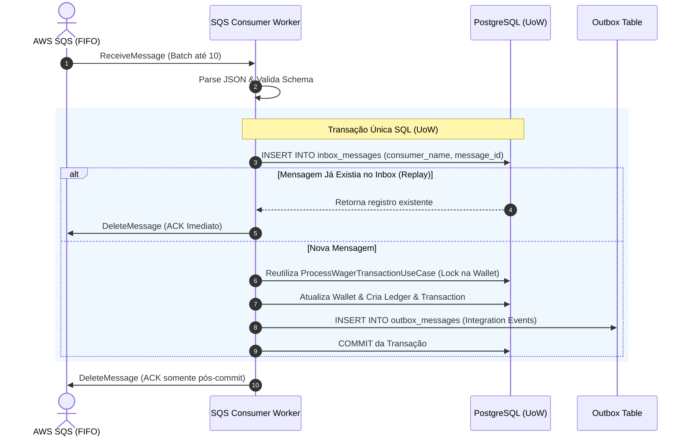

# Contrato do Consumidor SQS (wager-transactions.fifo)

<p align="center">
  <b>Distributed Wagering Processor — Hub de Documentação Técnica</b><br>
  <a href="../../README.md">README Principal</a> &nbsp;|&nbsp;
  <a href="../../ARCHITECTURE.md">Arquitetura (Staff)</a> &nbsp;|&nbsp;
  <a href="../REGRAS_DESAFIO.md">Regras do Desafio</a> &nbsp;|&nbsp;
  <b>Contrato SQS</b> &nbsp;|&nbsp;
  <a href="./integration-events.md">Eventos Outbox</a> &nbsp;|&nbsp;
  <a href="./http-status-mapping-matrix.md">Matriz HTTP</a> &nbsp;|&nbsp;
  <a href="../CHECKLIST_CONFORMANCE.md">Checklist de Auditoria</a>
</p>

---

Este documento define a especificação formal do consumidor assíncrono de mensagens de apostas via **AWS SQS FIFO**, cobrindo o contrato de payload, headers de transporte, controle de idempotência (Transactional Inbox), ciclo de ack e tratamento de falhas.

---

## 1. Topologia de Filas

| Fila | Tipo | Finalidade |
|---|---|---|
| `wager-transactions.fifo` | FIFO | Fila principal de entrada de apostas assíncronas submetidas por provedores. |
| `wager-transactions-dlq.fifo` | FIFO | Dead-Letter Queue (DLQ) para mensagens que falharam após o limite de tentativas (`maxReceiveCount = 3`). |

### 1.1 Configuração de Transporte SQS FIFO
- **`MessageGroupId`**: Deve ser preenchido com o **`walletId`**. Isso garante que mensagens destinadas à mesma carteira sejam entregues ordenadas pelo broker SQS (embora o PostgreSQL continue garantindo a serialização final via lock pessimista).
- **`MessageDeduplicationId`**: Preenchido com a **`idempotencyKey`** (ex: `provider-a:transaction-123`). O SQS aplica deduplicação na janela de 5 minutos, enquanto o banco aplica de forma permanente.

---

## 2. Contrato do Payload da Mensagem

As mensagens trafegadas na fila `wager-transactions.fifo` seguem rigorosamente a estrutura abaixo:

```json
{
  "messageId": "msg-123",
  "type": "WagerTransactionRequested",
  "occurredAt": "2026-10-30T07:50:00.000Z",
  "data": {
    "providerId": "provider-a",
    "externalTransactionId": "transaction-123",
    "idempotencyKey": "provider-a:transaction-123",
    "playerId": "0192f28f-5dc0-7d58-bdb2-814ad6a0f4a1",
    "walletId": "0192f291-27dd-7d3f-8071-5f8685deef37",
    "roundId": "round-987",
    "gameId": "fortune-chimp",
    "kind": "BET",
    "money": {
      "amount": "25.00",
      "currency": "BRL"
    },
    "referenceExternalTransactionId": null
  }
}
```

### Validações de Entrada (Guardrails de Esquema):
- `messageId`: Identificador único da mensagem no provedor/broker (usado no Inbox).
- `type`: Estritamente `"WagerTransactionRequested"`. Mensagens com tipos desconhecidos são enviadas para a DLQ.
- `occurredAt`: String ISO-8601 em UTC.
- `data.kind`: Um dos valores do enum `[BET, WIN, LOSS, REFUND, ROLLBACK]`.
- `data.money`: Objeto com `amount` (string decimal com 2 casas) e `currency` (`BRL`).
- `data.referenceExternalTransactionId`: Obrigatório se `kind` for `REFUND` ou `ROLLBACK`.

---

## 3. Fluxo de Execução & Ciclo de ACK

O consumidor segue a regra inviolável de **COMMIT BEFORE ACK**:



---

## 4. Classificação de Erros e Recuperação

O consumidor classifica os erros em 3 categorias operacionais estritas:

### 4.1 Erro de Regra de Negócio (Terminal → ACK imediato)
- **Exemplos:** `INSUFFICIENT_FUNDS`, `REFERENCE_ALREADY_REVERTED`, `ROLLBACK_WOULD_CAUSE_NEGATIVE_BALANCE`.
- **Ação:** O caso de uso persiste a transação como `REJECTED`, grava o evento `WagerTransactionRejected` no Outbox, executa o `COMMIT` e em seguida o worker emite o `DeleteMessage` (ACK) no SQS. A aposta foi processada (e rejeitada com auditoria), portanto a mensagem **não deve voltar** para a fila.

### 4.2 Erro Transitório de Infraestrutura (Retry com Backoff)
- **Exemplos:** Banco PostgreSQL momentaneamente inalcançável, timeout de conexão, deadlock transitório.
- **Ação:** O worker **não dá ACK** e devolve a mensagem ajustando o `VisibilityTimeout` (ou deixa expirar). O SQS redespachará a mensagem após o intervalo.

### 4.3 Erro Permanente de Formato (DLQ)
- **Exemplos:** Payload JSON malformado, campo obrigatório ausente que não passa no schema, tipo de moeda inválido.
- **Ação:** Após 3 tentativas (`ReceiveCount >= 3`), a política de redrive do SQS move a mensagem automaticamente para `wager-transactions-dlq.fifo`.

---

## 5. Graceful Shutdown (`SIGTERM`)

Quando o container recebe sinal de desligamento (`SIGTERM` do Docker ou Kubernetes):
1. O worker sinaliza parada imediata de polling (`isShuttingDown = true`).
2. Nenhuma nova chamada `ReceiveMessage` é disparada contra o SQS.
3. Aguarda até 10 segundos para que as mensagens já em processamento concluam seus commits e acks.
4. Caso alguma transação fique inacabada, ela sofre rollback seguro no banco e a visibilidade no SQS expira naturalmente para outra instância processar.

