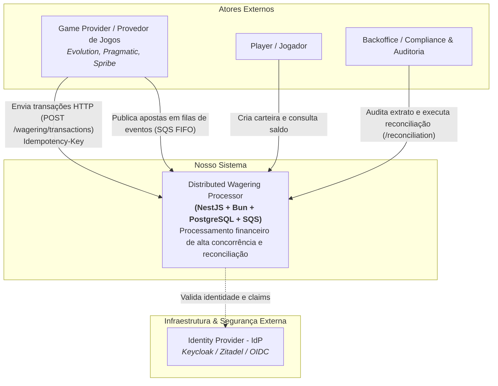
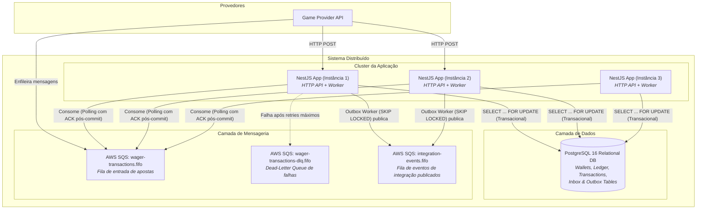
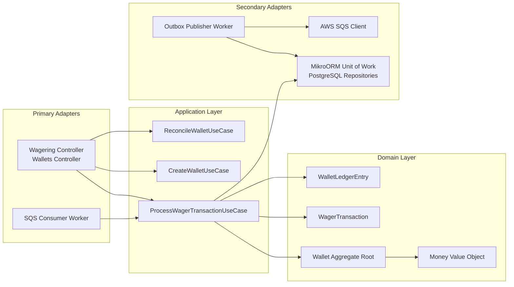

# Arquitetura do Sistema — Modelo C4

Este documento descreve a arquitetura do **Distributed Wagering Processor** utilizando os 3 primeiros níveis do **C4 Model** (Contexto, Containers e Componentes), facilitando o entendimento de fluxos e limites de responsabilidade.

---

## Nível 1: Diagrama de Contexto (System Context)

Mostra o sistema em relação aos atores externos, provedores de jogos e ecossistema de infraestrutura.

---

## Nível 2: Diagrama de Containers

Mostra a decomposição em aplicações executáveis, bancos de dados e sistemas de mensageria rodando no ambiente Docker Compose.

---

## Nível 3: Diagrama de Componentes (Clean Architecture)

Decomposição dos componentes internos da aplicação NestJS.

