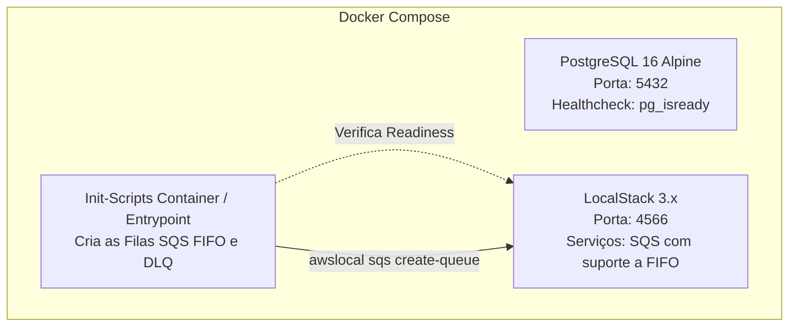

# Estratégia de Configuração e Provisionamento de Infraestrutura Local (Docker Compose)

Este documento especifica a infraestrutura local necessária para reproduzir fielmente o ambiente de produção do **Distributed Wagering Processor**, em conformidade com as Seções 4, 10 e 13 do `README.md`.

---

## 1. Topologia de Containers

O arquivo `docker-compose.yml` orquestra os serviços essenciais com health checks rigorosos:



---

## 2. Especificação das Filas no LocalStack (AWS SQS FIFO)

Na inicialização do LocalStack, um script automatizado provisiona as filas com seus atributos estritos:

### 2.1 Dead-Letter Queue (`wager-transactions-dlq.fifo`)
- **QueueName:** `wager-transactions-dlq.fifo`
- **Attributes:**
  - `FifoQueue: "true"`
  - `ContentBasedDeduplication: "false"` (deduplicação via `MessageDeduplicationId` explícito)
  - `MessageRetentionPeriod: "1209600"` (14 dias)

### 2.2 Fila de Entrada Principal (`wager-transactions.fifo`)
- **QueueName:** `wager-transactions.fifo`
- **Attributes:**
  - `FifoQueue: "true"`
  - `ContentBasedDeduplication: "false"`
  - `VisibilityTimeout: "15"` (15 segundos para failover rápido em caso de crash)
  - `RedrivePolicy`:
    ```json
    {
      "deadLetterTargetArn": "arn:aws:sqs:us-east-1:000000000000:wager-transactions-dlq.fifo",
      "maxReceiveCount": "3"
    }
    ```

### 2.3 Fila de Eventos Publicados da Outbox (`integration-events.fifo`)
- **QueueName:** `integration-events.fifo`
- **Attributes:**
  - `FifoQueue: "true"`
  - `ContentBasedDeduplication: "false"`

---

## 3. Configurações de Conexão e Tuning do PostgreSQL 16

Para suportar os testes de alta concorrência com 50 requests paralelas e 3 instâncias sem esgotar conexões nem mascarar locks:

| Variável | Valor Recomendado | Justificativa |
|---|---|---|
| `POSTGRES_DB` | `wagering_db` | Nome do banco transacional |
| `POSTGRES_USER` | `jungle` | Usuário da aplicação |
| `POSTGRES_PASSWORD` | `jungle_secret` | Credencial segura de desenvolvimento |
| `max_connections` | `200` | Suporta os pools combinados das 3 instâncias + suíte de testes de integração |
| `statement_timeout` | `10000` (10s) | Evita queries presas em ambiente de estresse |
| `lock_timeout` | `5000` (5s) | Falha rápido em caso de contenção anômala fora de teste |
| `idle_in_transaction_session_timeout` | `10000` (10s) | Desconecta transações zumbis que não deram commit/rollback |

---

## 4. Garantia de Inicialização Determinística (Readiness Order)

A aplicação NestJS só deve tentar se conectar após o PostgreSQL e o LocalStack estarem comprovadamente saudáveis:
- Utilização de `depends_on` com `condition: service_healthy` no `docker-compose.yml`.
- Healthcheck do PostgreSQL: `pg_isready -U jungle -d wagering_db`.
- Healthcheck do LocalStack: checagem via `curl -f http://localhost:4566/_localstack/health`.

