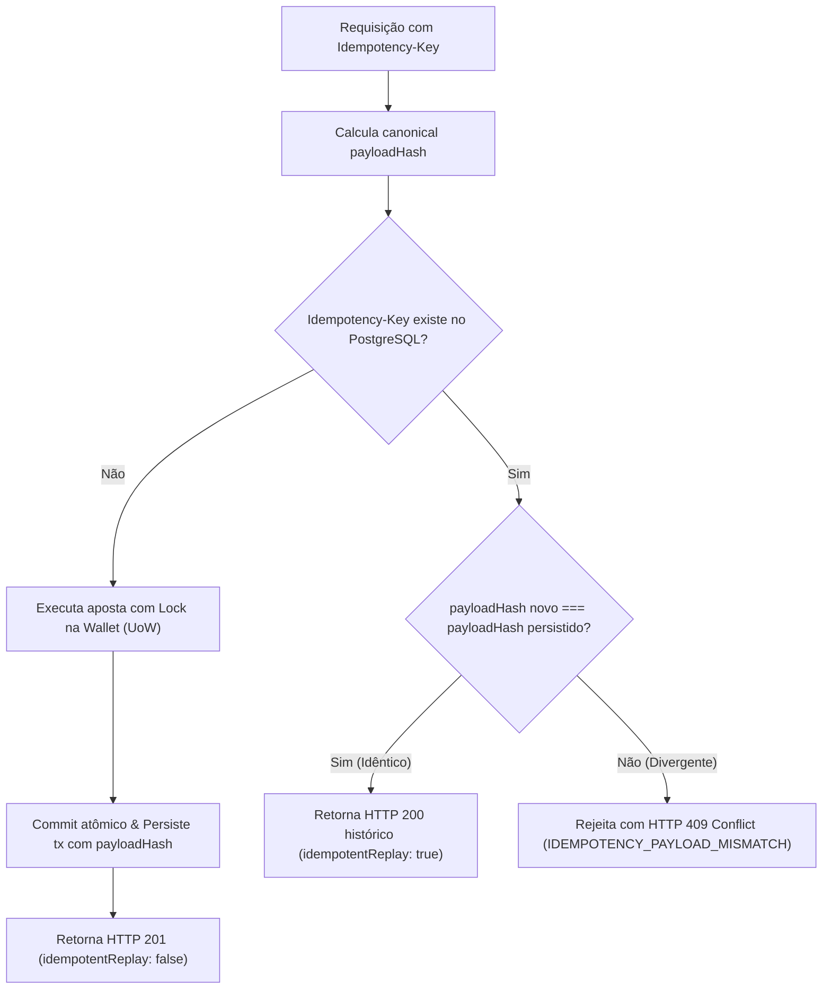

# Algoritmo de Hashing Canônico & Idempotência Estrita

Este documento descreve detalhadamente o algoritmo de cálculo do `payloadHash` e a mecânica de idempotência adotada no **Distributed Wagering Processor**, em conformidade com as Seções 6 e 9 do `README.md`.

---

## 1. O Problema da Idempotência em Sistemas Distribuídos

Em APIs financeiras, requisições HTTP podem sofrer retentativas automáticas (*retries*) por instabilidade de rede ou timeouts. O provedor de jogo reenvia a mesma mensagem com o mesmo header `Idempotency-Key`.

Duas situações fundamentais precisam ser diferenciadas:
1. **Replay Idempotente Legítimo:** O cliente enviou exatamente a mesma requisição (mesmos parâmetros de aposta). O sistema deve responder com sucesso (`HTTP 200/201`), retornando o estado histórico original com `"idempotentReplay": true`.
2. **Conflito de Idempotência (Tentativa de Reuso/Fraude):** O cliente reutilizou a mesma `Idempotency-Key`, mas alterou valores (ex: mudou o valor de 25.00 para 50.00 ou trocou o `playerId`). O sistema **não pode aplicar** a aposta e deve rejeitar imediatamente com **HTTP 409 Conflict** (`IDEMPOTENCY_PAYLOAD_MISMATCH`).

Para que isso funcione de forma imutável e à prova de falhas, calculamos o **Hash Canônico**.

---

## 2. O Algoritmo de Geração do `payloadHash`

### 2.1 Subconjunto Estrito de Campos de Negócio
Metadados de transporte (como headers HTTP, cookies, timestamps efêmeros ou IPs de origem) **não** entram no cálculo do hash, pois podem variar legitimamente entre retries.

Apenas os **10 campos semânticos de negócio** participam do hash:
1. `providerId` (string)
2. `externalTransactionId` (string)
3. `playerId` (string)
4. `walletId` (string)
5. `roundId` (string)
6. `gameId` (string)
7. `kind` (string, ex: `"BET"`)
8. `money.amount` (string, ex: `"25.00"`)
9. `money.currency` (string, ex: `"BRL"`)
10. `referenceExternalTransactionId` (string ou `null`)

### 2.2 Normalização & JSON Canônico (RFC 8785)
Em JSON, a ordem das chaves em um objeto não é garantida por padrão:
`{"amount": "25.00", "kind": "BET"}` e `{"kind": "BET", "amount": "25.00"}` representam o mesmo objeto conceitual, mas produziriam hashes SHA-256 completamente diferentes se serializados ingenuamente com `JSON.stringify()`.

**O Algoritmo de Canonicalização:**
1. Cria-se um objeto normalizado contendo apenas os 10 campos de negócio acima.
2. Todas as chaves de todos os níveis (inclusive objetos aninhados como `money`) são ordenadas lexicograficamente (ordem alfabética ASCII).
3. Espaçamentos em branco, quebras de linha e tabulações redundantes são eliminados (formato compacto).
4. O JSON canônico resultante é convertido em buffer UTF-8.
5. Computa-se o hash criptográfico **SHA-256** expresso em 64 caracteres hexadecimais minúsculos (`lower-case hex`).

---

## 3. Implementação de Referência (TypeScript Puro)

```ts
import { createHash } from "node:crypto";

export interface CanonicalPayloadInput {
  providerId: string;
  externalTransactionId: string;
  playerId: string;
  walletId: string;
  roundId: string;
  gameId: string;
  kind: string;
  money: {
    amount: string;
    currency: string;
  };
  referenceExternalTransactionId?: string | null;
}

export function computeCanonicalPayloadHash(input: CanonicalPayloadInput): string {
  // 1. Extração estrita e ordenação lexicográfica determinística
  const canonicalObject = {
    externalTransactionId: input.externalTransactionId,
    gameId: input.gameId,
    kind: input.kind,
    money: {
      amount: input.money.amount,
      currency: input.money.currency,
    },
    playerId: input.playerId,
    providerId: input.providerId,
    referenceExternalTransactionId: input.referenceExternalTransactionId ?? null,
    roundId: input.roundId,
    walletId: input.walletId,
  };

  // 2. Serialização canônica estável
  const canonicalJson = JSON.stringify(canonicalObject);

  // 3. Digest SHA-256
  return createHash("sha256").update(canonicalJson, "utf8").digest("hex");
}
```

---

## 4. Fluxo de Decisão no Use Case



