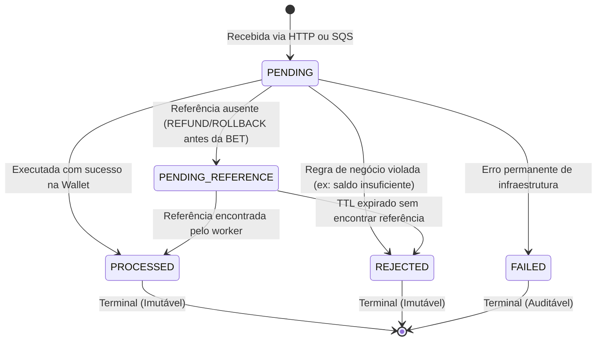

# Linguagem Ubíqua e Regras de Domínio (DDD)

Este documento formaliza o vocabulário oficial, as regras de negócio e os modelos conceituais do **Distributed Wagering Processor**, estabelecendo a base comum entre desenvolvedores, arquitetos e o domínio de **iGaming**.

---

## 1. Glossário de Termos Ubíquos

| Termo | Definição |
|---|---|
| **Player (Jogador)** | Entidade externa (usuário final) que realiza apostas e recebe prêmios. Identificado por um UUID (`playerId`). |
| **Provider (Provedor de Jogo)** | Plataforma externa que fornece os jogos (ex.: Evolution, Pragmatic, Spribe). Identificado por `providerId`. |
| **Game (Jogo)** | Instância de um jogo de cassino fornecido por um Provider (ex.: `fortune-chimp`). |
| **Round (Rodada)** | Ciclo de jogo com início e fim demarcados. Uma rodada contém uma ou mais apostas e seus desdobramentos (vitória, derrota, estorno). |
| **Wallet (Carteira)** | Aggregate Root que gerencia o saldo materializado de um jogador em uma moeda específica. Relação 1:1 entre `(playerId, currency)`. |
| **Wager Transaction** | Transação financeira ou auditável associada a uma aposta ou desdobramento de aposta. |
| **Wallet Ledger Entry** | Registro imutável de movimentação financeira (extrato auditável). Garante a rastreabilidade histórica do saldo. |
| **Idempotency Key** | Identificador único enviado pelo provedor para garantir que uma operação duplicada não gere duplo débito ou crédito. |
| **Payload Hash** | Hash criptográfico (SHA-256) dos campos semânticos de negócio de uma requisição, utilizado para detectar divergência de payload na mesma chave. |
| **Transactional Outbox** | Padrão arquitetural onde eventos de integração são gravados no mesmo banco de dados relacional e na mesma transação atômica das entidades de negócio. |
| **Transactional Inbox** | Padrão arquitetural que registra o `messageId` recebido de um broker na mesma transação da execução do caso de uso, evitando duplo processamento. |

---

## 2. Tipos de Operação (`WagerTransactionKind`)

| Operação | Direção Financeira | Efeito no Ledger | Regras de Negócio |
|---|---|---|---|
| `OPENING` | Crédito Interno | 1 entrada `CREDIT` | Operação estritamente interna executada na criação da carteira quando `initialBalance > 0`. Não pode ser submetida por API externa nem por fila. |
| `BET` | Débito | 1 entrada `DEBIT` | Aposta do jogador. Requer saldo disponível igual ou superior ao montante. Se insuficiente, a transação é rejeitada (`REJECTED`) com `INSUFFICIENT_FUNDS`. |
| `WIN` | Crédito | 1 entrada `CREDIT` | Ganho do jogador em uma rodada. Pode referenciar a `BET` correspondente. Gera crédito imediato. |
| `LOSS` | Neutro (Sem valor) | Nenhuma entrada | Indica que o jogador perdeu a aposta. Não altera saldo nem gera lançamento de extrato, mas a transação é persistida como `PROCESSED` para histórico e auditoria. |
| `REFUND` | Crédito | 1 entrada `CREDIT` | Estorno de uma `BET` anterior. Requer que a `BET` referenciada esteja em `PROCESSED`. Deve estornar exatamente o mesmo valor e moeda da `BET`. Pode ocorrer apenas uma vez por aposta. |
| `ROLLBACK` | Inversão do Referenciado | 1 entrada invertida | Reversão genérica de uma operação anterior (`BET`, `WIN` ou `REFUND`). Se o referenciado for `BET`, gera crédito; se for `WIN`, gera débito. Rejeitado caso o débito gere saldo negativo. |

---

## 3. Ciclo de Vida & Máquina de Estados da Transação



### Regras de Transição:
1. **Estados Terminais:** `PROCESSED`, `REJECTED` e `FAILED` são definitivos. Nenhuma transição é permitida a partir desses estados. Tentativas lançam `InvalidTransactionStateError`.
2. **Pending Reference:** Se um `REFUND` ou `ROLLBACK` for recebido antes da respectiva `BET`, a transação é persistida com status `PENDING_REFERENCE`. O worker de background reprocessará a mensagem com backoff exponencial até encontrar a referência ou estourar o TTL (15 minutos).

---

## 4. Invariantes Matemáticas do Ledger

O ledger é construído sobre o princípio de contabilidade imutável:

1. **Aritmética Exata:**
   ```text
   Se direction = CREDIT: balanceAfter = balanceBefore + amount
   Se direction = DEBIT:  balanceAfter = balanceBefore - amount
   ```
2. **Consistência Global (Reconciliação):**
   A qualquer momento, o saldo materializado da carteira deve ser igual ao somatório do ledger:
   ```text
   wallet.balance = soma(Creditos) - soma(Debitos)
   ```
3. **Auditoria Estrita:** Nenhuma linha do ledger pode ser modificada (`UPDATE`) ou excluída (`DELETE`).

