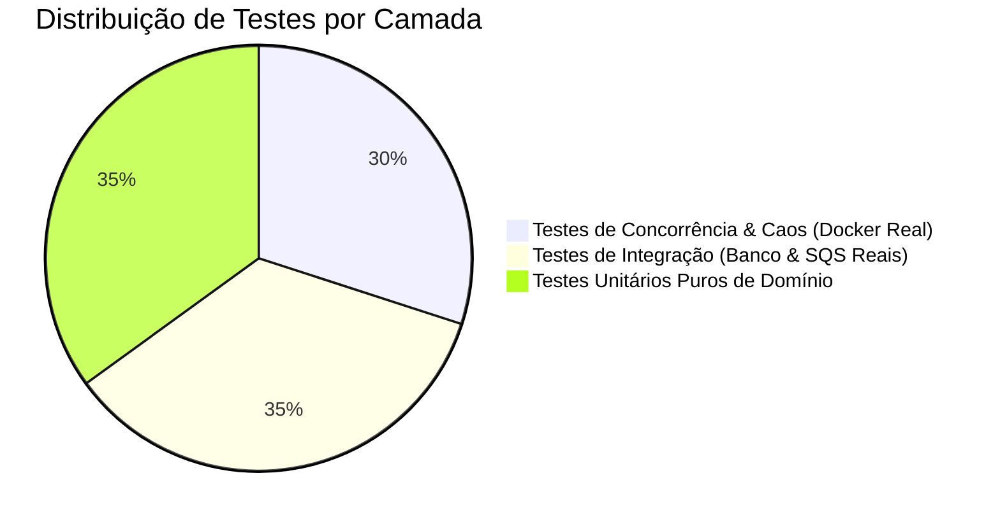

# Estratégia de Testes, Matriz de Concorrência & Evidências

Este documento define a estratégia formal de testes automatizados do **Distributed Wagering Processor**, guiada pelo princípio de engenharia do CEO da Jungle Gaming: *"Evidence before assumption"*.

Para garantir nota máxima e eliminar qualquer risco de reprovação, adotamos a política de **Zero Mocks de Infraestrutura** nos testes de integração e concorrência: todos rodam contra instâncias reais de **PostgreSQL 16** e **LocalStack AWS SQS** orquestradas via Docker.

---

## 1. Pirâmide de Testes



### 1.1 Testes Unitários Puros (`bun test src/**/*.spec.ts`)
- **Foco:** Lógica pura de regras de negócio, sem banco de dados e sem rede.
- **Cobertura Obrigatória:**
  - `Money`: Precisão decimal com escala 2, arredondamento bancário, adição, subtração, rejeição de strings inválidas (`NaN`, notação científica, negativas em contratos).
  - `Wallet`: Abertura, cálculo de novo saldo, incremento de `version`, rejeição de saldo negativo.
  - `WagerTransaction`: Máquina de estados, validação de transições válidas e erro ao tentar transicionar estado terminal (`PROCESSED`, `REJECTED`, `FAILED`).
  - `WalletLedgerEntry`: Verificação aritmética estrita `balanceBefore ± amount == balanceAfter`.
  - Hash Canônico: Determinismo do SHA-256 com chaves JSON em ordens aleatórias.

### 1.2 Testes de Integração Real (`bun test:integration`)
- **Foco:** Validar o ciclo transacional, migrations, persistência MikroORM e mensageria SQS real.
- **Cobertura Obrigatória:**
  - Migrações reversíveis do PostgreSQL e aplicação de constraints físicas (`CHECK`, `UNIQUE`).
  - Atomicidade do Unit of Work: se o Outbox falhar, o saldo e o ledger sofrem rollback.
  - Transactional Inbox: garantia de que a mesma mensagem de SQS não é executada duas vezes.
  - Ciclo de vida do Transactional Outbox: inserção no banco e publicação assíncrona com `SKIP LOCKED`.

---

## 2. Matriz dos 8 Cenários Obrigatórios de Concorrência (Seção 13 do README)

Cada cenário foi desenhado para provar a consistência do sistema sob estresse severo de corrida (*race conditions*).

| # | Cenário de Teste | Mecânica de Disparo | Invariante de Negócio Verificada | Critério de Aprovação |
|---|---|---|---|---|
| **C1** | **50 Requests Idênticos em Paralelo** | 50 chamadas HTTP simultâneas via `Promise.all()` com a mesmíssima `Idempotency-Key` e payload. | Apenas **1 único débito** ocorre na carteira. | 1 resposta com `idempotentReplay: false`, 49 respostas com `idempotentReplay: true` e saldo idêntico. Ledger contém exatamente 1 lançamento. |
| **C2** | **Disputa de Hot Wallet (Seção 8)** | Carteira com `100.00 BRL`. Dois workers disparam simultaneamente apostas de `80.00 BRL`. | Saldo nunca pode ficar negativo (`-60.00 BRL`). | Exatamente **1 aposta processada** e **1 rejeitada** por `INSUFFICIENT_FUNDS`. Saldo final: `20.00 BRL`. Ledger com 1 lançamento. |
| **C3** | **Wallets Distintas em Paralelo** | 20 carteiras diferentes recebem apostas concorrentes simultaneamente. | Lock em carteira `A` não bloqueia carteira `B`. | Todas as 20 apostas processam em paralelo com baixa latência e sem deadlocks. |
| **C4** | **Escalabilidade com ≥ 3 Instâncias** | Três processos/containers da aplicação consumindo a mesma fila SQS e banco de dados. | Nenhuma duplicata ou lost update em ambiente multi-instância. | Distribuição de carga confirmada; consistência final perfeita do saldo. |
| **C5** | **Crash Pós-Commit Antes do ACK** | Worker processa aposta, comita no PostgreSQL e é finalizado abruptamente (`SIGKILL`) antes do `DeleteMessage` no SQS. | Redelivery da mensagem não duplica o débito. | O SQS redespacha a mensagem; o novo worker consulta o Inbox, detecta a chave já processada e faz ACK imediato sem mexer no saldo. |
| **C6** | **Publishers Concorrentes de Outbox** | Dois processos de outbox executando loop com `SKIP LOCKED` sobre 100 mensagens pendentes. | Nenhuma mensagem do outbox é publicada duas vezes no broker. | Exatamente 100 mensagens chegam na fila de destino. |
| **C7** | **Reversão Fora de Ordem (`REFUND` antes da `BET`)** | Envia `REFUND` para a fila antes da `BET` correspondente existir. | O sistema não descarta nem rejeita prematuramente. | A transação é salva como `PENDING_REFERENCE`. Quando a `BET` é inserida e o worker agendado roda, o `REFUND` é processado com sucesso. |
| **C8** | **Invariante Final Global de Reconciliação** | Executado ao final de todos os testes concorrentes. | Consistência matemática contábil absoluta. | **`wallet.balance == SUM(credits) - SUM(debits)`** retornado por `POST /wallets/:id/reconciliation` com `consistent: true`. |

---

## 3. Automação e Execução de Testes

Os testes são executados através de comandos npm/bun padronizados:

```bash
# Testes unitários rápidos
bun test

# Subir infraestrutura Docker de teste (Postgres + LocalStack)
docker compose -f docker-compose.test.yml up -d

# Testes de integração reais
bun run test:integration

# Bateria completa de concorrência e estresse (C1 a C8)
bun run test:concurrency

# Teste opcional de carga (diferencial)
bun run test:load
```

